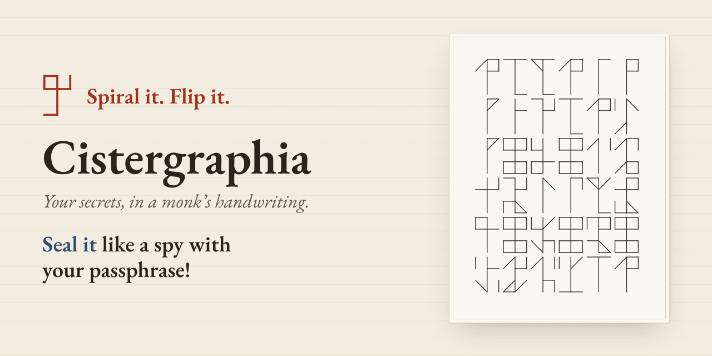
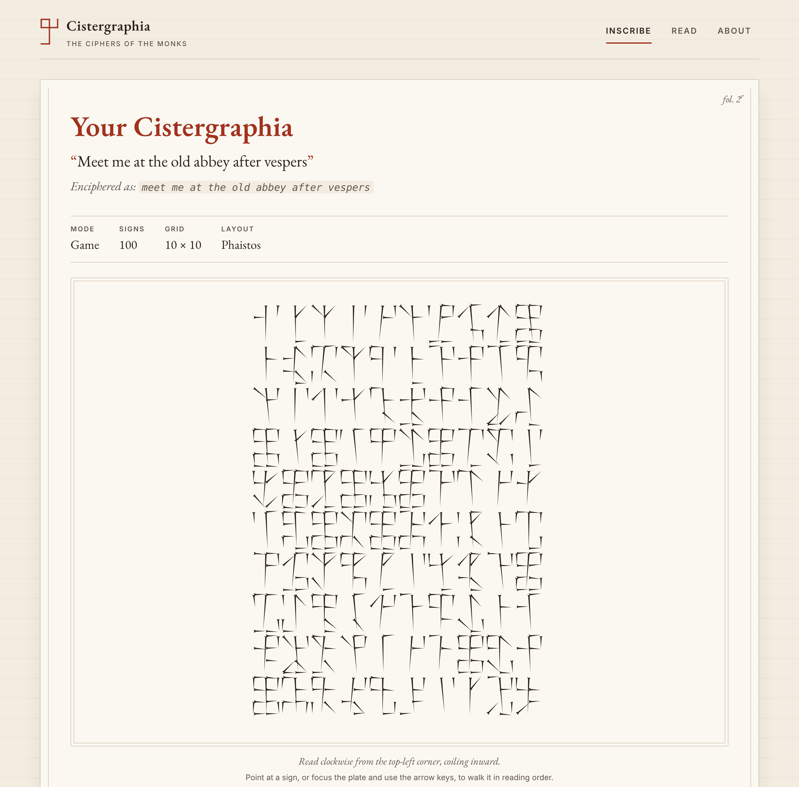

Cistergraphia
=============

**Spiral it. Flip it. Seal it like a spy with your passphrase!**
*Your secrets, in a monk's handwriting.*



Every script draws a circle around its readers. Latin bound a continent of clerks, shorthand a
profession, the invented alphabet of a schoolyard two friends. Cistergraphia borrows one of the
smallest circles in the history of writing, the numerals of the Cistercian monks, and opens it
just wide enough for you and the person you are writing to.

Why a monks' numeral?
---------------------

In the thirteenth century, a way of writing numbers spread through the Cistercian houses: one
stem and four corners, for units, tens, hundreds and thousands, so that any number up to 9,999
became a single sign. It was a script of the cloister, compact and elegant, and opaque to anyone
outside it. It escaped only in thin threads: onto an astrolabe made in Picardy, into Agrippa's
*Three Books of Occult Philosophy* in 1533, into the measures of the wine-gaugers of Bruges. Then
it went quiet, until David A. King's *The Ciphers of the Monks* (2001) gave it back its history.

Rare scripts survive the way small languages do: not by being useful to everyone, but by meaning
something to someone. A sign that only a few can read is a sign of belonging. Cistergraphia gives
that old belonging a new use. Each letter of your message becomes a monk's number, and each number
a sign, so a line of text becomes a page that looks eight hundred years old and reads, to the
right eyes, like a note passed across the room.


*Saint Bernard of Clairvaux, reformer of the Cistercian order. Engraving by
Dominicus Custos, Augsburg, c. 1579–1615, from the series* Icones institutorum
sex illustrium in Christiana religione ordinum. *[Rijksmuseum, Amsterdam,
RP-P-OB-31.620](https://hdl.handle.net/10934/RM0001.COLLECT.100170), public
domain ([Wikimedia Commons](https://commons.wikimedia.org/wiki/File:H._Bernardus_van_Clairevaux_Icones_Institutorum_sex_illustrium_in_Christiana_religione_ordinum_(serietitel),_RP-P-OB-31.620.jpg)).*

Why turn the page?
------------------

How a script is read is a habit of the body before it is a rule of grammar. Two undeciphered
scripts kept their gestures long after they lost their readers:

- On **Crete**, the Phaistos Disc carries its signs in a spiral, read clockwise from the rim to
  the centre.
- On **Rapa Nui**, the readers of rongorongo turned the tablet half round at the end of every
  line, so that every other line stood upside down.

Their meanings are lost; their movements are not. A Cistergraphia plate keeps the movement and
lends it to your words: it coils inward like the disc, or climbs and turns like the tablets. The
hand remembers what the alphabet forgot.

A third gesture belongs to the cipher-makers. In 1550 Girolamo Cardano laid a pierced sheet on
a letter and wrote his secret through the holes; three centuries later the sheet learned to
turn, a quarter at a time, until every cell of the page had passed under a hole. Jules Verne hid
a whole novel's plot under one. A Grille plate is written like a page and read like a secret:
without its parchment, it is an anagram of itself. Give it a second message and it gets a second
reader: the abbot's grille reads the real one, the novice's grille, cut from the cells the abbot's
leaves, reads the other.

Old records reach us damaged, and arithmetic outlives the damage: the Inka khipus repeat their
cords' values as sums on higher cords, and in 2024 two fragments of a broken one were rejoined
by that arithmetic alone. A weathered plate has lost some strokes. Each pair must still add up
to a value on the tablet, so the restoration is the puzzle: press the lost digits back in and
each pair is weighed. The decoder prints the edition the way epigraphers do: `[r]` restored,
`[b/l]` for the words to decide. With tally signs (the CLI's `--tally`), the sums of every row and
column on a higher cord, a plate can lose whole signs and still be restored. A broken plate comes
in two to four fragments, some turned half round, in a tray under an empty board: their edges are
worn, so only the sums show where each one goes. Rejoin them on the page, or let the decoder try
every arrangement and keep the one whose pairs all balance. A broken plate can be weathered too:
a worn sign is weighed by every digit it may have held, and the plate, whole again, reads as an
edition. The form offers these as a ladder, Intact, Worn, Broken, Ruined. Send a plate to someone
and Read opens it as its puzzle, built from the file alone: the reading desk for an intact plate
(read it pair by pair, guided or unaided), the bench to restore a worn one, the board to rejoin a
broken one, the decoder's answer one click below.

Why two ways to send it?
------------------------

A message is a social contract before it is a string of bytes. Cistergraphia offers two, and is
honest about both.

**The riddle.** Without a passphrase, a plate is a puzzle, the oldest gift between people who
enjoy each other's minds. It assumes the reader can solve it, and they can. So, given patience,
can a machine: a model given nothing but the images read ten messages out of ten in a few minutes.
A grille only makes it work harder: ten out of ten again, in twenty-six minutes. Send a riddle to
be found out.

**The seal.** With a passphrase, the same signs carry something else: your exact words, locked with
a modern, standard cipher (AES-256-GCM). Without the passphrase, a sealed plate gives away nothing
but its length; tamper with the message and it refuses to open. This is not the secrecy of
obscurity, which never lasts, but the secrecy of a shared word, which lasts as long as you both
keep it.

The [security study](docs/security-study.md) shows the experiments, the limits, and what a seal
does not protect.

The experience: the silence of the monks
----------------------------------------

A Cistercian scriptorium was a place of discipline and quiet. Cistergraphia is built to feel like
one.

It looks like a leaf from an abbey's index (vellum, iron-gall ink, ruled lines), and it writes
with only two inks, as the reformed order allowed itself: red for the riddle, blue for the seal.
Signs are not displayed; they are pressed wedge by wedge,
like a stylus in clay, and then the ink dries. Nothing moves under your hand while you write: no
line jumps, no field slides away, nothing claims attention you did not give. When something is wrong, the page says so in place, in plain words, and keeps what
you wrote.

Reading is the real game. Walk a plate sign by sign. Turn a tablet to read the lines that stood
upside down. Learn the signs the way a novice did, one corner at a time, until the numbers begin to
read themselves. Mistakes are shown, never punished. Here, as in the cloister, literacy is an
initiation: from novice to abbot.



Try it
------

```
bundle install
bundle exec rackup                                      # then open http://localhost:9292
./cistergraphia -m "Meet me at the old abbey after vespers"
./cistergraphia -m "Vespers at six" -g K7Q2M-ZXB4P --stencil grille.svg  # -l grille draws a new key
./cistergraphia -d tmp/inline.svg -g K7Q2M-ZXB4P                          # read it under its grille
./cistergraphia -m "The relics are under the third stone" --decoy "Vespers at six" -g K7Q2M-ZXB4P
                                     # two readers: K7Q2M-ZXB4P reads both, the novice's key only the decoy
./cistergraphia -m "Ora et labora" --weathered            # some strokes lost; -d prints the edition
./cistergraphia -m "Ora et labora" --weathered --tally    # with row and column sums: whole signs may go
./cistergraphia -m "Ora et labora" --broken               # in fragments; -d rejoins them by their sums
./cistergraphia -m "Ora et labora" --broken --weathered   # worn fragments; -d rejoins them, then the edition
```

A web server sees what you seal on it: serve it over HTTPS, or use the command line, which keeps
everything on your own machine (`./cistergraphia --help`). It needs Ruby 3.2 or later (4.0 is
pinned in `mise.toml`) and, to export PNGs, librsvg (`rsvg-convert`) or ImageMagick.

For builders
------------

```
bundle exec rake test                 # unit and HTTP tests
bundle exec rubocop                   # lint
bundle exec rake ui:stability         # nothing on a page moves under the reader (needs Playwright)
experiments/cryptanalysis/run.sh      # attack both modes (needs python3, wamerican, wfrench)
bundle exec rake og:image             # social preview images (needs Chromium)
```

The cipher lives in `lib/`, the leaf in `app.rb`, `views/`, `web/` and `public/`, the command line
in `cistergraphia`. The design and its rules are in [docs/design.md](docs/design.md); the
cryptanalysis is in [experiments/cryptanalysis](experiments/cryptanalysis). In Claude Code cloud
sessions, `.claude/hooks/session-start.sh` installs everything above.

Further reading
---------------

- David A. King, *The Ciphers of the Monks: A Forgotten Number-notation of the Middle Ages*,
  Stuttgart: Franz Steiner, 2001 ([summary](https://en.wikipedia.org/wiki/The_Ciphers_of_the_Monks))
- [King: ciphers paper (PDF)](http://akira.ruc.dk/~jensh/Publications/2002%7bR%7d21_King_Ciphers.PDF)
- [Cistercian Numbers: Magic of the Boy Scouts](https://glossographia.wordpress.com/2013/07/09/cistercian-number-magic-of-the-boy-scouts/)
- [Cistercian Numerals: Ciphers of Monks](http://luxoccultapress.blogspot.fr/2013/01/cistercian-numerals-ciphers-of-monks.html)
- [Rongorongo](https://en.wikipedia.org/wiki/Rongorongo), [Phaistos Disc](https://en.wikipedia.org/wiki/Phaistos_Disc)
- [Cardan grille](https://en.wikipedia.org/wiki/Cardan_grille), [Grille (cryptography)](https://en.wikipedia.org/wiki/Grille_(cryptography))
  and the sources they cite
- [History of Cryptography](https://en.wikipedia.org/wiki/History_of_cryptography)
- [dCode: Cistercian numbers](https://www.dcode.fr/cistercian-numbers)
- On the cryptanalysis and the seal: [docs/security-study.md](docs/security-study.md#sources)
