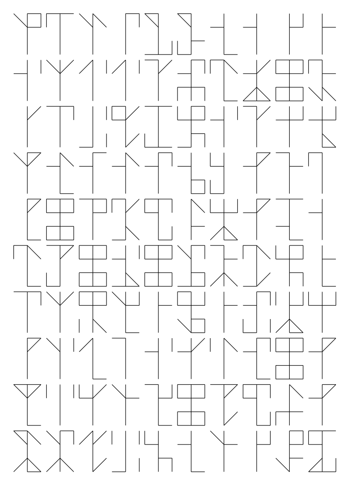
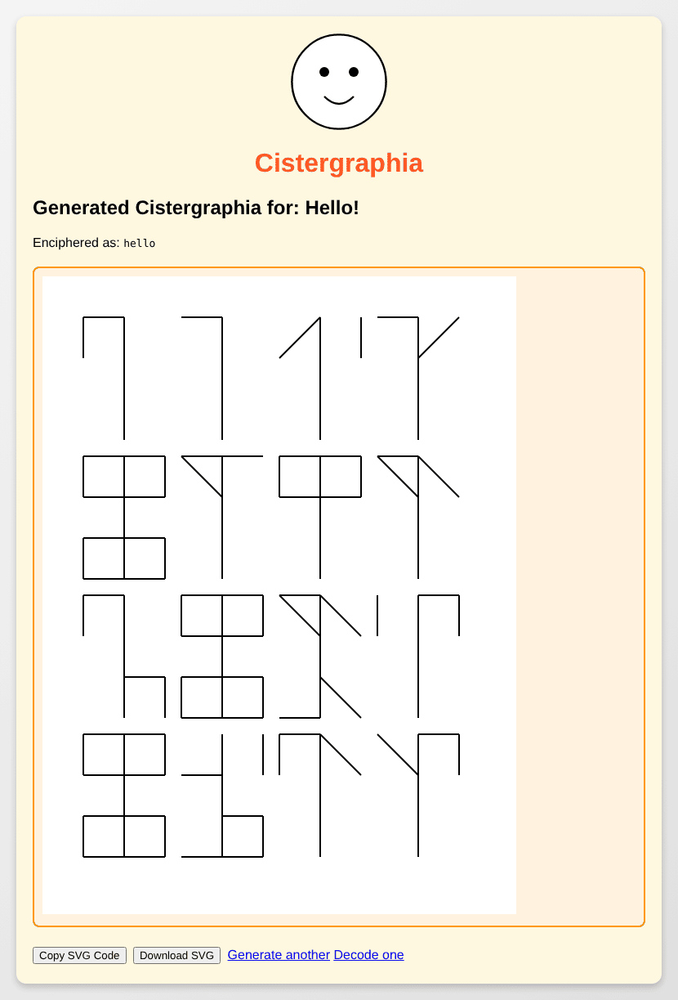

Cistergraphia
=============

About
-----

...an old index full of mystery that the cistercian monks used to make 
an inventory of their library serves as a pretext for an encryption game. 
Many ideas are behind it, such as the way the Easter Island natives used to write... snail-shaped.


How it works
------------

1. **Tablet.** Each letter (and the space) maps to a number from the tablet
   (`a` = 1 … `r` = 19, `s` = 100 … `z` = 800, space = 900), multiplied by 10.
   Other characters (digits, punctuation, accents) become spaces.
2. **Split.** Each number is split into two random parts that add up to it, so
   the same message gives a different picture every time.
3. **Evil symbols.** Noise pairs ending with `9999` pad the sequence until it
   fills a perfect square. No character can produce 9999, so they are easy to
   remove when decoding.
4. **Cistercian numerals.** Each value (0–9999) becomes one glyph: units in the
   top right, tens in the top left, hundreds in the bottom right, thousands in
   the bottom left.
5. **Snail.** The glyphs are laid out clockwise in a spiral, starting at the top
   left and ending in the middle.

Decoding runs these steps backwards. It only works on SVGs generated by
Cistergraphia, because it reads the exact stroke geometry.

> This is a cipher game, not encryption: there is no key, so anyone with the
> decoder can read the message.

Usage
-----

```
$ ./cistergraphia -m "Le navire est proche du point de rendez-vous"
# writes tmp/inline.svg and tmp/output.png (shown in the terminal if chafa is installed)

$ ./cistergraphia -m "Le navire est proche du point de rendez-vous" -o navire.svg -p navire.png

$ ./cistergraphia -d docs/example.svg
le navire est proche du point de rendez vous
```

Run without `-m` to type the message interactively.



Dependencies
------------

* Ruby >= 3.2 (pinned to 4.0 in `mise.toml`) and bundler (`bundle install`)
* librsvg2-bin (for SVG to PNG conversion; ImageMagick is used as a fallback)
  - Ubuntu/Debian: `sudo apt install librsvg2-bin`
  - macOS: `brew install librsvg`
  - Fedora: `sudo dnf install librsvg2-tools`

Web UI
------

To run the web UI, use `bundle exec rackup` and open http://localhost:9292.
Messages can be encoded on `/`, and downloaded SVGs (or their pasted code) can
be decoded on `/decode`.



Development
-----------

```
bundle exec rake test   # unit + HTTP tests
bundle exec rubocop     # lint
```

Code map:

* `lib/cistergraphia.rb` — the cipher (tablet, split, evil symbols, snail) and the public API: `encode`, `to_svg`, `decode`
* `lib/cistergraphia/glyphs.rb` — Cistercian numeral geometry, number ⇄ strokes
* `lib/cistergraphia/svg.rb` — snail layout, SVG writing and reading
* `app.rb` / `views/` — Sinatra web UI
* `cistergraphia` — command-line interface

References
==========

- [Cistercian Numbers: Magic of the Boy Scouts](https://glossographia.wordpress.com/2013/07/09/cistercian-number-magic-of-the-boy-scouts/)
- [The Ciphers of the Monks](https://en.wikipedia.org/wiki/The_Ciphers_of_the_Monks)
- [King Ciphers PDF](http://akira.ruc.dk/~jensh/Publications/2002%7bR%7d21_King_Ciphers.PDF)
- [Cistercian Numerals: Ciphers of Monks](http://luxoccultapress.blogspot.fr/2013/01/cistercian-numerals-ciphers-of-monks.html)
- [Create a Stacked Cipher](https://www.wikihow.com/Create-a-Stacked-Cipher)
- [History of Cryptography](https://en.wikipedia.org/wiki/History_of_cryptography)