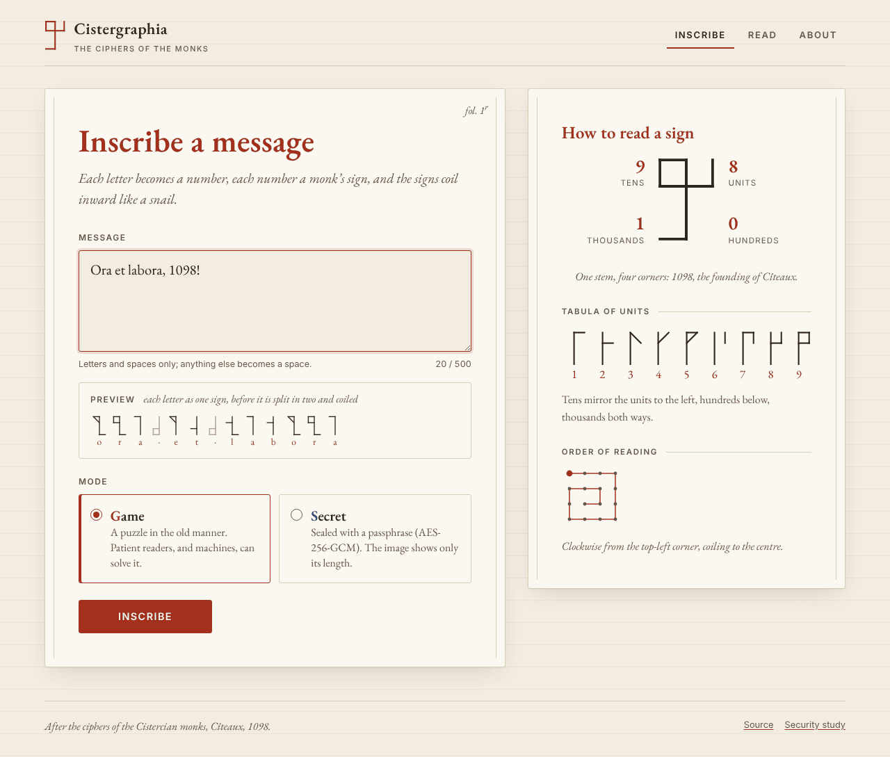
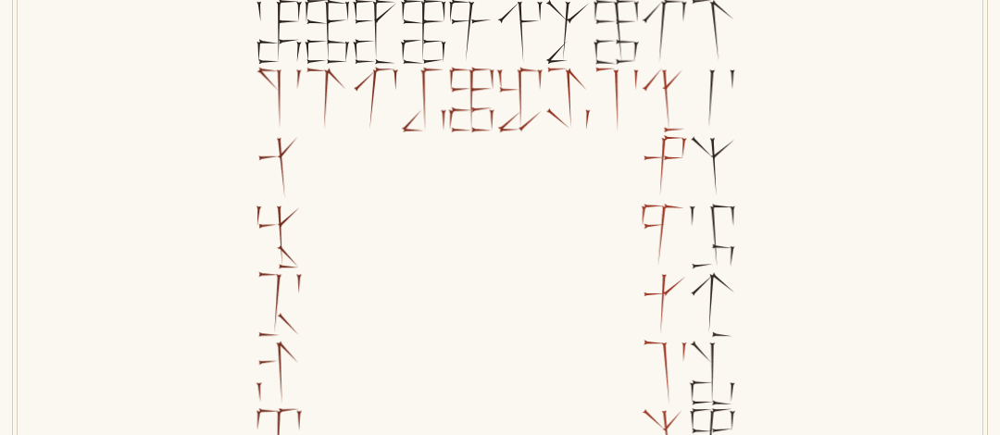
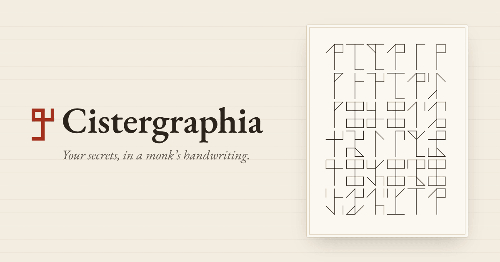
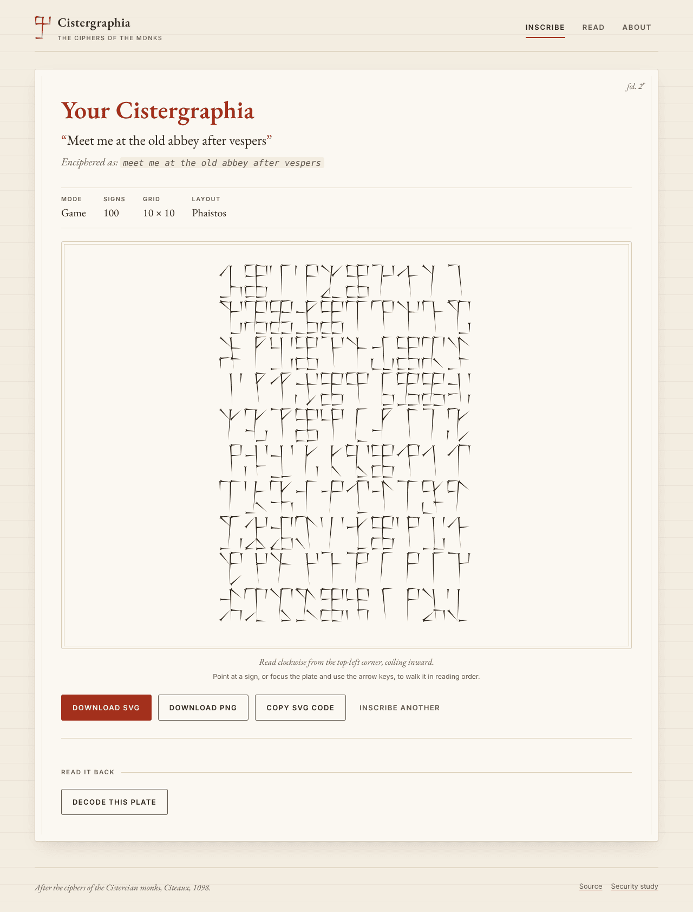
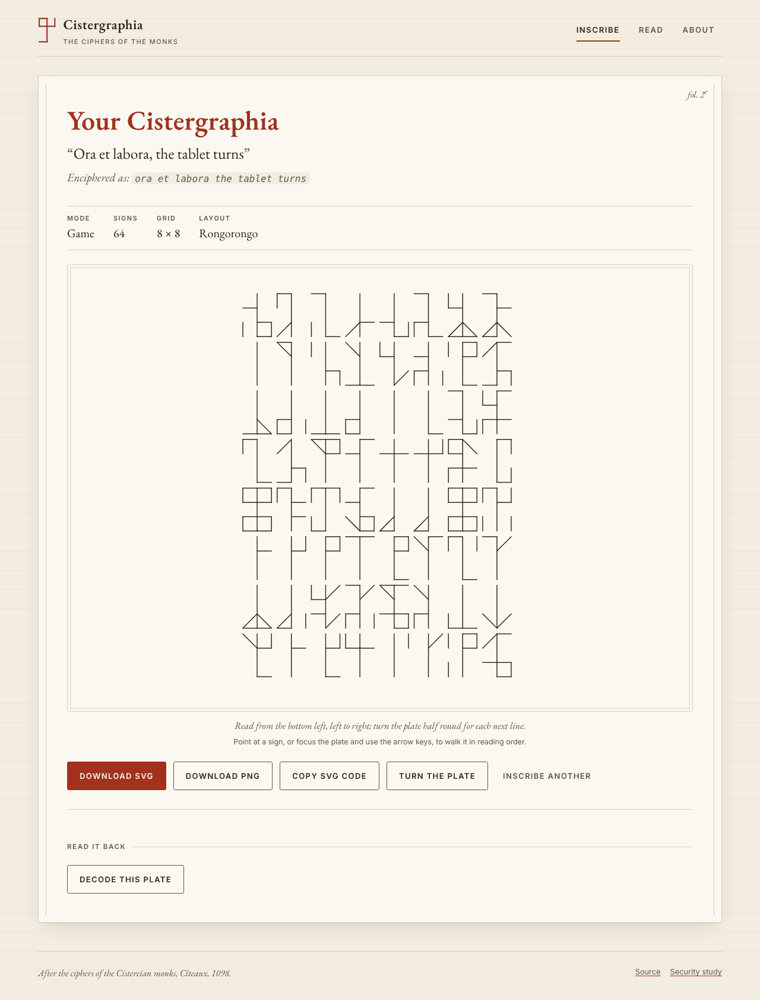
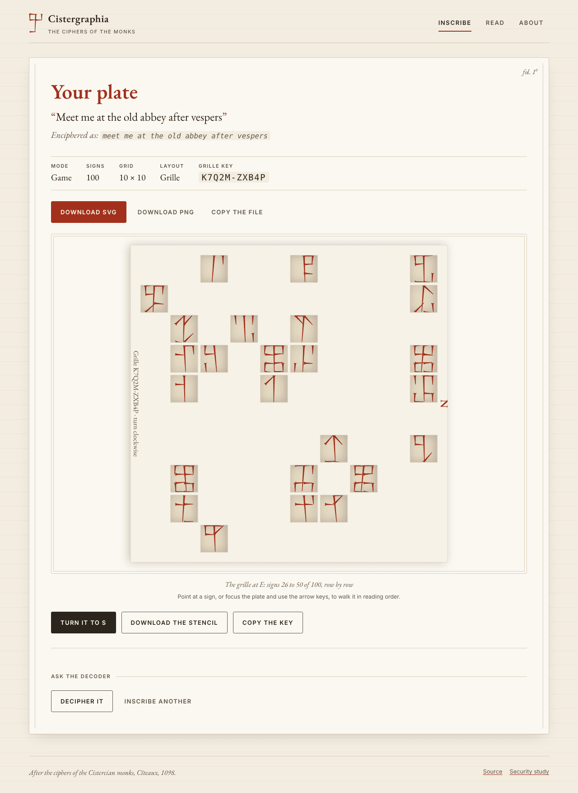
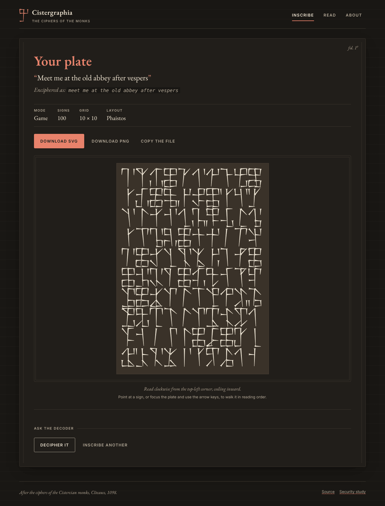
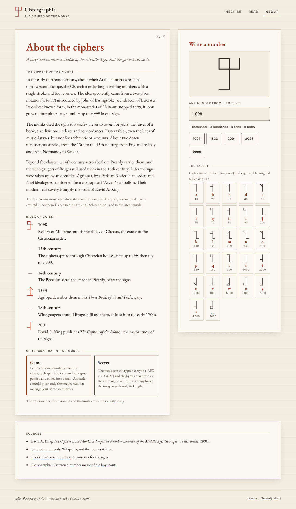

# Design: "The Abbey Index"

The web UI is styled as a leaf from a Cistercian library index: the catalogue the monks
kept of their books, where the numerals behind this cipher were used.

## Concept

**Cistercian restraint is already modern.** St Bernard's reforms banned gold, colour and
ornament from the order's buildings and books. What remained (undyed vellum, iron-gall ink,
ruled lines, and plain initials in one colour) is close to today's minimalism. The UI keeps
that restraint and adds modern structure: a grid, clear controls, real states and motion.

Three ideas carry the design:

1. **Two colours, two modes.** Cistercian scribes allowed themselves monochrome initials in
   red *or* blue. Here **minium red is the game** and **woad blue is the sealed secret**. The
   whole page (headings, buttons, focus rings, the brand mark) changes colour with the mode,
   so the user always knows which one they are in.
2. **The page teaches the cipher.** The key beside the form (one sign's anatomy, the units
   tabula, the snail) is drawn from the real cipher geometry (`Cistergraphia::Glyphs`), so it
   can never drift from what the encoder produces.
3. **Motion shows the reading order.** On the result page each sign is pressed in reading
   order, so the path (the snail, or the turning rows) is visible the first time you see a
   plate. It is off under `prefers-reduced-motion`.
4. **Every sign is pressed by hand.** Signs are wedges, as a stylus leaves them in clay: a
   notched head where it bites, a tail that thins as it lifts, pressed left to right and
   top-down like a cuneiform tablet, with a slight unevenness of the hand. One look
   everywhere: plates, the key, the preview, the tables, Lectio, the mark and the favicon.
   The hand is seeded, so nothing changes between visits: on a plate by each sign's place,
   on the page by each stroke, so a stroke looks the same in every sign that has it and a
   morphing sign keeps the strokes it shares. Small signs get optical weight (`--weight`, a
   stroke the colour of the fill) so they stay legible.

## Tokens

All values are CSS custom properties in [`public/css/app.css`](../public/css/app.css).

| Token | Light (vellum) | Dark ("Vigils") | Use | Contrast |
|---|---|---|---|---|
| `--vellum` | `#f3ede1` | `#191714` | page, inputs | |
| `--paper` | `#fbf8f2` | `#211e1a` | leaves | |
| `--ink` | `#2b241c` | `#ece4d4` | text, glyphs | 13–14 : 1 |
| `--ink-soft` | `#62574a` | `#b3a894` | secondary text, control borders | 6–7.6 : 1 |
| `--rubric` | `#a3301c` | `#e8826b` | game accent | 6–6.7 : 1 |
| `--woad` | `#2b4a74` | `#93b3e3` | secret accent | 7.7–8.5 : 1 |
| `--rule` | `#d9cdb6` | `#3b352d` | ruling lines (decorative only) | |
| `--accent` | rubric, or woad when `body[data-mode="secret"]` | | everything mode-coloured | |

Every text colour passes WCAG AA, most of them AAA. Control borders use `--ink-soft` to meet
the 3:1 non-text contrast rule.

**Type.** EB Garamond (OFL, self-hosted, ~75 KB for three cuts) for reading text,
headings and messages, with old-style figures. The system sans is used, letter-spaced in
capitals, for labels and buttons: the "index" voice. The system mono is used for SVG code
and the passphrase.

**Space.** A 4 px based scale (`--space-1` to `--space-8`), a reading measure of 62ch, and a
3 px radius (manuscripts are not rounded; controls are, slightly).

## Components

| Component | Notes |
|---|---|
| Leaf (`.leaf`) | Paper card with the double vertical bounding lines of a ruled writing area; folio mark (`fol. 1r`…) top right, hidden on phones |
| Rubric (`.rubric`) | Page title in the mode colour |
| Index heading (`.index-heading`) | Small capitals followed by a hairline rule |
| Choices (`.choice`, `.segment`) | First on the form, above the message: **Mode** (Game, Secret; red and blue initials) and **Layout** (Phaistos, Rongorongo, Grille) as segmented controls over native radios, one above the other (three layouts need the leaf's width). Each has one reserved line of description; the notes swap in place. The key's "Order of reading" shows the chosen path; hollow points mark signs written upside down, and the grille's figure letters each cell with the turn that reads it. Then **Condition**, the difficulty ladder (`.segments--ladder`): one segmented control, four rungs, Intact, Worn, Broken, Ruined, each a complete design, with one reserved note describing the rung chosen. A rung the layout does not allow (Broken and Ruined follow the snail) is greyed, and choosing it puts the reason in the note instead of an error after sending; in secret mode the rungs past Intact are greyed and the note says why (a sealed plate that loses a stroke never opens again). Tally signs are the library's and the CLI's, not the form's |
| Mode cards (`.mode`, About) | Native radios styled as two index cards; the first letter is a red or blue initial |
| Fields | Labels in small capitals; vellum-filled inputs; a focus ring in the mode colour |
| Buttons | Primary uses the mode colour; secondary is outlined; quiet is link-like; all are at least 48 px tall |
| Plate (`.plate-frame`) | The signs pressed in wedges (`Cistergraphia::Stylus`: head 12, head length 14, tail 6, variation 6, in glyph units), in ink colours (CSS only), inside a double frame, scaled to fit the viewport |
| Drop zone | Large dashed target; works by drag, click or keyboard |
| Transcription | The decoded text with a plain two-line initial (`initial-letter`, with a float fallback). Read with the abbot's key, the novice's message follows under its own heading, in a quieter ink (`.transcription--second`). A weathered plate's text is an edition in the Leiden conventions: restorations `[r]` in rubric (`.leiden-restored`), doubts `[b/l]` dotted under (`.leiden-doubt`); the reveal keeps each letter's class |
| Toast | A polite live region, instead of `alert()` |
| Live preview (`.preview`) | Under the message, a strip of fixed height: each letter as one sign while typing, before the split and the layout. It scrolls sideways and follows the caret. Its three states (empty, signs, sealed) share one cell, so it never changes size |
| Passphrase, grille key (`.slot`) | Below the message, unfolded by CSS (`:has`): the grille key and the novice's message when Grille is chosen (both optional: a grille already shared, empty draws a new one; a second message for a second reader), the passphrase in secret mode. Only the button below them moves, over `--dur-mode` |
| Grille (`.grille-sheet`) | The plate's stencil (`Cistergraphia::SVG.stencil`, the same file as Download the stencil) laid exactly over the plate, in parchment colours; its N turns with it. Grille plates have square cells (170 × 170, the sign centred) so that a quarter turn lands on the grid again. A plate with two readers carries two stencils, the abbot's and the novice's, which share no hole; a segmented control (`.grille-choice`) picks the one laid |
| Playground (About) | Any number from 0 to 9,999 drawn as a sign, with its reading ("1 thousand · 0 hundreds · …") and preset years |
| Index of dates (About) | A timeline whose exact years are written as signs; centuries get an em dash |
| Tablet (About) | The 27 letters as index cards: sign, letter in the mode colour, value |

## Voice and lexicon

The frame that holds the three worlds the site draws on (the Cistercian abbey, the archaeology of
undeciphered writing, the cipher register): **Cistergraphia is an abbey library that keeps the
world's lost scripts. The leaf is the catalogue, the plate is the object, the scriptorium is where
readers work.** Every surface belongs to one of the three rooms; a feature that fits none is a
fourth voice, and is declined.

| Room | What is in it |
|---|---|
| The catalogue | The leaves: Inscribe, Read, About, the Erratum. Index headings, folio marks, the lede in italic. It describes; it does not perform |
| The collection | The plates: clay pressed by a stylus, sometimes worn, broken or ruined; the grille cut from parchment; the tablet of values. Objects have conditions, layouts and keys |
| The scriptorium | Where the reader works: the desk, the bench, the board; Lectio; the ranks from novice to abbot; the record of plates read. Its verbs are manual: read, press, lay, turn, restore |

**Voice.** A careful epigrapher writing a catalogue entry: declarative, exact, unhurried, with a
dry wit that never winks ("Without it, the plate is an anagram of itself").

- Sentences state; they do not sell. No exclamation marks, no "you can", no "simply".
- The colon is the house punctuation: a claim, a colon, its consequence. Semicolons on About
  only; em-dashes never.
- Mistakes are shown in rubric and left to the reader ("Neither sign reads that. Look again."),
  never corrected, never named "wrong".
- Progress is a count a scribe would keep ("7 of 32 restored", "2 plates read"): never a score,
  a timer or a streak outside Lectio's own "in a row".
- Technical words stay at the doors: SVG, PNG and AES-256-GCM appear where a file enters or
  leaves (the download row, the Read form, the seal's note), never in a lede, a heading or a
  puzzle line.
- Latin and the monks' words earn their place by having no plain equivalent (Lectio,
  scriptorium, folio, erratum, lacuna) and are never explained twice.
- Red means one thing at a time: wet ink, a restoration, or "look here".

**Lexicon.** One word for each thing, in pages, scripts, docs and refusals alike.

| We say | For | Never |
|---|---|---|
| plate | the object a message becomes | image, "a Cistergraphia" (the site's name is not a noun), file except at the doors |
| sign; stroke, corner, stem | one numeral and its parts | glyph, symbol (code only); quadrant in copy |
| pair, balance, the tablet | two signs summing to a letter; the table of values | checksum, lookup |
| intact, worn, broken, ruined | the ladder's four conditions | weathered, damaged (except as the family word on About) |
| lacuna, restore, edition | a lost stroke position, putting it back, the Leiden-bracketed result | gap, repair, fix |
| fragment, sherd, rejoin, whole again | the pieces of a broken plate and the act | piece in copy, reassemble, solve |
| inscribe | what the scribe does | generate, encode, create |
| read | what a person does to a plate | decode (a person never decodes) |
| decipher, the decoder | what the machine does, and its name | decode this plate, decoded message, solver |
| seal, sealed, passphrase | secret mode and its key | encrypt, password, lock |
| key, grille, stencil | the grille's secret, the parchment, the printed cut-out | code, mask |
| the snail, the turning tablet, the turning parchment | the three layouts, by their movement | spiral mode, boustrophedon outside About |
| scribe, reader | the two people in every exchange | user, player, sender |
| the desk, the bench, the board | the scriptorium's furniture | mode, puzzle view, game screen |
| Lectio; novice, monk, prior, abbot | the reading exercise and the ranks it and the desk award | level, XP, badge |
| your scriptorium | the record of plates read, kept in the browser | history, stats, profile |
| transcription | what the decoder hands back | output, result, decoded message |

**The codex.** The folios follow the order the story is read: Inscribe `1r`, the plate `1v`,
Read `2r`, the scriptorium `2v`, the transcription `3r`, About `4r`. The Erratum has no folio: a
slip of paper in the book.

## Interaction: "the silence of the monks"

Motion and interaction follow four rules. Anything that breaks one does not ship.

1. **Motion only when it carries meaning.** Nothing loops, nothing moves for show; every
   animation either teaches how the cipher works or answers something you did.
2. **One vocabulary: ink.** A wedge is *pressed* (the stylus bites at its head and runs to
   its tip, wet in the mode's colour, then the ink dries to iron-gall) or *lifted* (it fades). A sign changes by *morphing*:
   shared strokes stay, only the difference is pressed. Never a pop, a bounce or a shake.
3. **The game is reading.** The page invites you to read the signs yourself, at your own
   pace: no timers, no sound, no confetti. Mistakes are shown, not punished.
4. **Silence by default.** Under `prefers-reduced-motion`, everything is instant and the
   same information is still there.

**Red means one thing at a time.** Wet ink and "look here" share the mode colour, so lighting
a corner first dries any wet ink: the only red left is what you should look at.

### Motion tokens

| Token | Value | What it is |
|---|---|---|
| `--dur-stroke` | 260 ms | one stroke of the pen |
| `--dur-dry` | 1100 ms | wet rubric ink drying to iron-gall |
| `--dur-lift` | 260 ms | a stroke lifted away |
| `--dur-mode` | 700 ms | the page changing ink, red ↔ blue (a registered `@property`) |
| `--dur-turn` | 900 ms | a Rongorongo plate turned half round, or the grille a quarter |
| stroke gap | 70 ms | between two strokes of one sign, like a scribe's hand |
| `--ease-ink` | `cubic-bezier(0.3, 0.6, 0.2, 1)` | quick to start, slow to settle |

### Catalogue

| Where | Interaction | What it teaches |
|---|---|---|
| Whole page | Choosing a mode crossfades the page's ink red ↔ blue | The mode you are in |
| Inscribe preview | Each new letter's sign is pressed as you type, stroke by stroke; existing signs stay; the strip glides sideways to keep the caret's sign in view | One letter, one sign |
| How to read a sign | The four corners are dials (click, or arrow keys up/down); only the changed strokes are rewritten; hovering a corner lights its strokes; some years name themselves (1098, 1115, 1153, this year) | How the places combine |
| Inscribe | Choosing Secret unfolds the passphrase below the message | What sealing needs |
| Inscribe key | Choosing a layout re-inks the "Order of reading" path, in place | Where the plate starts and how it runs |
| Plate | Pressed stroke by stroke in reading order, each wedge running from its head to its tip, the wet rubric front visibly coiling inward (or climbing the rows). Past 1,200 wedges (about 85 letters in a game) the signs are too small to see a stroke run: the plate is there at once and only its ink dries along the path, which keeps 60 fps | The reading order |
| Plate | Walk it: point at a sign, or focus the plate and use the arrow keys / Home / End; a soft field glides along the path; "Sign 12 of 36 · 4127", with "upside down: turn the plate to read it" on turned signs | Reading the numerals, the first step of solving a game plate |
| Plate (Rongorongo) | **Turn the plate**: the plate rotates half round, as the readers of Rapa Nui turned their tablets; the turned rows now read upright, and walking follows | Why every other row is upside down |
| Plate (Grille) | **Lay the grille**, then **Turn it to E, S, W**: the parchment turns a quarter at a time and the signs under its holes are lit, "The grille at E: signs 26 to 50 of 100, row by row"; walking says which turn reads a sign. **Download the stencil** to print and cut, **Copy the key**. With two readers: **Abbot / Novice** picks the grille, each lights only its own signs; both stencils download, each key copies | How a turning grille reads every cell once, and that without it the plate is an anagram; with two readers, that one plate holds two messages for two keys |
| Transcription | The decoded message appears letter by letter after its initial | The payoff of decoding |
| Plate (weathered) | The lacunae are hatched in the leaf's parchment, under the wedges; walking a worn sign says "worn: part of this sign is lost", never its value. **Ask the decoder** prints the edition | That a lost stroke is recovered by balancing its pair, and where the words must decide |
| Restoration bench (`.bench`) | Under a weathered plate: choose a lacuna on the plate (its whole cell when the sign has one lacuna, its corner when it has several) or step with ‹ ›; a line counts how many are restored ("7 of 32 restored"); ten digits drawn in the lacuna's place, those the surviving strokes rule out disabled; press one and its strokes are pressed in rubric where the surface is lost. The pair is weighed in two short lines ("0045 + 000? = ?", "Press a digit to balance it.") and the edition so far updates in Leiden style. A sign wholly lost is four lacunae, one per place. With tally signs, a third line checks the lacuna's row and column in its place ("Tallies, tens: row ✓, column ?"). The page only knows what the file shows: it says whether things balance, never whether a restoration is right | Restoration as the puzzle: the checksum narrows a lacuna, the words (or the tallies) settle it |
| Plate (broken, `.plate--broken`) | The board, ruled in the leaf's colour, and the tray: two to four fragments of clay (`.sherd`), worn on every edge, lying slightly askew, some turned half round. The file has the tray below the board (a phone shows it so); on a wide screen the script lays it beside the board in a frame of fixed height, so the whole puzzle is in view at once and nothing on the page moves when it does. With the script a fragment is dragged, or picked (tap or Enter) and laid by choosing the cell for its top-left corner; a dashed ghost (`.ghost`) shows the cells it would land on, grey when it would hang over the edge; arrow keys move it a cell at a time, **T**, a double click or **Turn half round** turns it; everything snaps to the cells. The plate is not walked: it is in pieces | That shapes do not rejoin a plate, the sums do |
| Rejoining (`.rejoin`) | Under a broken plate: the tools, then one two-line status ("On the board: 2 of 3 fragments.", "Covered: 38 of 50 pairs balance.", "Whole again: every pair balances.") and, once whole, what it reads. A weathered broken plate shows its lacunae on the fragments; a worn sign is weighed by every digit its strokes allow, and whole again the plate reads as the decoder's edition ("It reads, restored: la[b/l]ora") and **Restore it** comes alive: it posts the file back (`rejoined=1`) and the bench opens on the plate drawn whole from its own fragments, each moved to its place, the ruined plate's last step and where it is won. No bench on a plate still in pieces. The page holds what each fragment shows, read upright and turned, never where it goes: it weighs the pairs along both reading paths only once the board is covered | The khipu rejoined by arithmetic, as a game |
| Tally signs (`.tally`) | One sign past each row and under each column, and the corner, in rubric past two ruled cords (`.cord`), like the higher cords of a khipu | That every row and column is summed, place by place |
| About · Lectio | Read the sign, type its number. Novice (units) → Monk (tens) → Prior (hundreds) → Abbot (thousands) every three in a row; a misread corner is lit (an empty corner is named as a zero) and you continue when ready; best run kept in the browser | Fluency in the signs |
| Read | A received file's sign is pressed | Your file arrived |
| Scriptorium record (`.record`) | One reserved line under Read's lede: "Your scriptorium: Prior · 7 plates read, 4 worn, 2 broken and 1 ruined." Counts by rung, kept in the browser (`localStorage`), nothing else: no times, no streaks, no scores on the plate. A plate won on the reader's page (read to the end, every pair balanced, whole again) adds one and says so in the same reserved line under its puzzle | A record of a scribe's and a reader's exchange, not a leaderboard |
| Reading desk (`.desk`, under an intact plate on Read) | The current pair shown large (two signs on vellum), two numbers to type, the sum and its letter on the tablet ("4127 + 873 = 5000: “e”"), the text so far growing in a line of dots. **Guided**: a tap on a sign, on the plate or on the desk, shows its value in its box; **Unaided**: a wrong value is marked in rubric and never corrected, the plate walk keeps the values to itself, and three right pairs in a row earn the Lectio's ranks, the same best kept in the browser. A null pair (an intact 9999) reads as nothing. The field on the plate follows the pair | Reading the numerals in context: the lowest rung, and the one most readers meet first |
| Read (a game plate, `play.erb`) | A game plate brought to Read opens as its puzzle, not its reading: the desk under an intact plate, the bench under a worn plate, the board under a broken one (then the bench, rejoined, under a ruined one), the same as the plate page's but built from the file alone (its surviving strokes, its fragments' edges), so the page cannot hold the answer. The file is redrawn from its plate elements only before it is shown. **Decipher it** below posts the same file back with `decipher=1` for the decoder's edition or rejoining; the plate page's **Read it back** carries the same field, since the scribe knows the answer. An intact plate is read at once; a sealed one is never a game | The reader's game: the plate arrives damaged, the one who receives it restores it |

Implementation: `public/js/ink.js` holds the vocabulary (`press`, `wet`, `dry`, `lift`, `morph`,
`glyph`). A wedge's drawing is read from its own outline (where the head bites, which way the
tail runs) and is a stretch along the stroke from there; drawing and drying are two animations
in turn, never at once, because animating shape and colour together on thousands of SVG paths
drops the frame rate several times over. `public/js/app.js` holds the interactions.
The plate's cells and geometry come from
`ViewHelpers#plate_cells_json` / `#plate_layout_json` (built from `Cistergraphia::Layout.path`, with
each sign's turned flag, and the cell's size), so walking the plate follows the real path.
Under a grille, a wedge's cell is read from where it bites, to light the signs under the holes. Turning is a class on
the frame, never on the SVG, and exports strip every class, style and the walking field: the
downloaded SVG is unchanged.

## Engineering rules the design depends on

- **Nothing moves under you.** Typing, choosing, walking or turning a plate never changes
  where anything above it sits, and the script arriving moves nothing: what JS changes has
  its space from the first paint (stacked cells for swapped text, `visibility` for controls
  JS enables, server-drawn first states, reserved lines for the longest text). The one
  deliberate movement is the passphrase unfolding in secret mode, which moves only the
  button below it, animated. `bundle exec rake ui:stability` checks it, and CI runs it on
  every push: each reader action on every page, at 320, 390, 1024 and 1280 px, and each
  page with JS on vs off. A new interaction gets a step in `test/ui/stability.js`; a new
  deliberate movement names its anchor there, above which nothing may move.

- **No inline script or style.** CSS, JS, fonts and the favicon are first-party files, so
  `Content-Security-Policy: default-src 'self'` applies. The page talks to no third party, which
  matters for an app that handles passphrases.
- **Progressive enhancement.** Without JS, every form works: both modes, decoding, and the
  read-it-back form. JS adds the mode switch, counter, reveal, exports, drag and drop, and
  the animation.
- **Exports stay decodable.** A plate file holds its pressed wedges (one path per stroke) and
  every stroke as a hidden `<line>`: the decoder reads the lines, the wedges are only the look,
  and plates drawn before the wedges still read. Display styling is CSS-only, and the
  animation's inline styles are stripped before Download SVG, PNG or Copy.
- **Accessible by default.** Real labels, a native radio group (arrow keys work), visible
  focus, a skip link, `aria-live` feedback, reduced motion respected, and no horizontal scroll at
  390 px. axe-core reports no WCAG 2.1 AA violations on any page, in either theme.
- **No caching of secrets.** `POST` responses are sent with `Cache-Control: no-store`.
- **One copy of the cipher, and of the hand.** The live preview and the playground draw from
  a JSON glyph table the server embeds (`ViewHelpers#glyph_table_json`, built from
  `Cistergraphia::Glyphs`), with every stroke's wedge already pressed (`Cistergraphia::Stylus.press`).
  A test checks that it equals the library's, so the browser can never drift from the encoder.

## Social preview

`bundle exec rake og:image` renders `web/og/card.html.erb` with the app's fonts and a real
plate ("ora et labora", fixed seed, so the image is reproducible and decodable), through
headless Chromium:

- `public/og.png` (1200×630): `og:image` and `twitter:card` on every page
- `docs/social-preview.png` (1280×640): to upload in the repository's GitHub settings
  (Settings → General → Social preview)

## Screens

| Inscribe (secret selected) | Plate (game) | Plate (Rongorongo) | Plate (grille, at E) | Plate (dark) | About |
|---|---|---|---|---|
|  |  |  |  |  |  |
